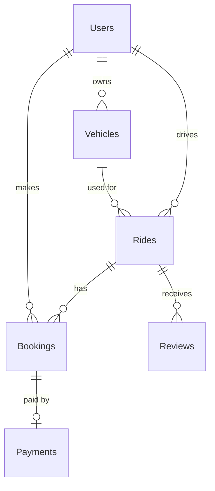

<div align="center">

# 🚗 CampusRide

**A university carpooling platform: drivers post rides, students search and book seats, with JWT auth and a normalised SQL Server database behind it.**


*Database Systems Lab · FAST NUCES Lahore*

</div>

---

## Overview

Getting to campus is expensive and most cars travel with empty seats. CampusRide lets students who drive offer their spare seats, and lets other students find a ride on the same route and book it.

The project was built in two phases: **(1)** design and implement a relational schema for a full ride-sharing domain, **(2)** build a working full-stack app on top of it.

## Features

- 🔐 **Sign up and log in** with bcrypt-hashed passwords and **JWT**-protected routes
- 🚘 **Drivers:** create, edit and cancel rides (route, departure time, seats, price per seat)
- 🔎 **Passengers:** search rides by source and destination, see ride details, **book seats**
- 📋 **My Rides / My Bookings** dashboards, with booking cancellation
- 🧾 **Transactional booking:** the booking insert and seat decrement commit atomically in one SQL Server transaction, and cancelling restores the seats
- 👤 Profile page and protected client-side routing (React Router)

## Database design

14 tables in a normalised schema:

`Users` · `Vehicles` · `Rides` · `Bookings` · `Payments` · `Reviews` · `Routes` · `Preferences` · `Notifications` · `EmergencyContacts` · `CarpoolGroups` · `GroupMemberships` · `Reports` · `FareCalculations`



- [`Group5-phase1.sql`](Group5-phase1.sql): schema with keys, constraints and relationships
- [`Group5-phase2.sql`](Group5-phase2.sql): seed data and a full query set covering joins (inner, left, right, full outer), subqueries, `GROUP BY` / `HAVING`, aggregates, and `UNION` / `INTERSECT` / `EXCEPT`
- [`Docs/`](Docs/): project proposal and phase reports

## API

| Method | Endpoint | Auth | Description |
|---|---|:---:|---|
| `POST` | `/api/auth/signup` | | Register |
| `POST` | `/api/auth/login` | | Log in, returns a JWT |
| `GET` | `/api/auth/verify` | 🔒 | Validate the token |
| `GET` | `/api/rides` | | List and search rides |
| `GET` | `/api/rides/:id` | | Ride details |
| `POST` | `/api/rides` | | Create a ride |
| `PUT` | `/api/rides/:id` | | Update a ride |
| `DELETE` | `/api/rides/:id` | | Delete a ride |
| `POST` | `/api/bookings` | 🔒 | Book seats (transactional) |
| `GET` | `/api/bookings/my` | 🔒 | My bookings |
| `PUT` | `/api/bookings/:id/cancel` | 🔒 | Cancel a booking |

## Getting started

**Prerequisites:** Node.js 18+, SQL Server Express (`localhost\SQLEXPRESS`) with Windows authentication, and ODBC Driver 17 for SQL Server.

```powershell
git clone https://github.com/fast-na-ana/campusride.git
cd campusride
.\setup-db.ps1     # creates the CampusRide database and runs both SQL phases
.\setup.ps1        # installs backend and frontend dependencies
```

Copy `backend/.env.example` to `backend/.env` and set `JWT_SECRET`, then start both servers:

```powershell
.\run.ps1          # backend on :5000, frontend on Vite's dev port
```

## Tech stack

| Layer | Tech |
|---|---|
| Frontend | React 19, Vite, Tailwind CSS, React Router 7, Axios |
| Backend | Node.js, Express 5, JWT, bcrypt |
| Database | Microsoft SQL Server (`mssql` / `msnodesqlv8`) |

## Team

Group 5, Database Systems Lab:

- Abdullah Saeed, [@fast-na-ana](https://github.com/fast-na-ana)
- [@FatimaAsif1126](https://github.com/FatimaAsif1126)

## License

[MIT](LICENSE)
